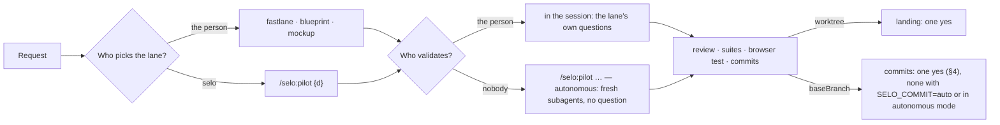

# selo 2.6 — `/selo:pilot`: selo picks the lane, autonomous or not (proposal, 2026-10-24, decided 2026-10-25)

Working document. One change in `selo`, its echo in `selo-ops`, and the shape of Selo Ops' new-session page:

- **selo 2.6.0**: `/selo:pilot {request}` replaces `/selo:autopilot`. Without a suffix it picks the lane and runs it in the session, with the lane's usual questions. With ` — autonomous` it is today's autopilot, unchanged. Routing leaves `selo.yaml` for the person's settings (`SELO_ROUTING=on` in `~/.claude/settings.json`, off by default): `on` sends a free change request through `pilot`. A fastlane on `baseBranch` commits on one yes, unless the person sets `SELO_COMMIT=auto` (§4).
- **selo-ops 2.8.0**: the export carries what the prompt says, as is: `skill: "pilot"`, `mode: "autonomous"` when the suffix is there, `flow: "pilot"`. Nothing derived (§3.2).
- **Selo Ops, new-session page** (another repository): the person types a free request; the page builds the command (§2).

Basis: the session « Routing et autopilote » (2026-10-24), a read of `skills/autopilot`, `scripts/lane-hint.mjs`, `reference/rules.md`, `docs/manifest.md` and `selo-ops/scripts/ops.mjs` at selo 2.5.0 / selo-ops 2.7.1. Decisions of 2026-10-25: the name `pilot`, one yes per commit, the export raw.

## 1. Why

Two questions decide how a request is handled: **which lane** (fastlane or blueprint) and **who validates** (the person, or nobody). Today each cell of that grid has its own entry, and two of them overlap:

| | The person validates | Nobody validates |
|---|---|---|
| **The person picks the lane** | `/selo:fastlane`, `/selo:blueprint`, `/selo:mockup` | `/selo:autopilot … — fastlane` / ` — blueprint` |
| **selo picks the lane** | `routing: suggest` (a hook's note, no one-shot command) | `/selo:autopilot {request}`; `routing: auto` for a fastlane-sized change |

`routing: auto` is an autopilot cut down to the fastlane, run in the main session, on a sentence nobody typed as a command. It also carries the risk `docs/manifest.md` already names: on `baseBranch` a fastlane commits without a question. And Selo Ops' new-session page needs one command per cell, not a config value read at session start.

The grid wants one skill for the row « selo picks » and one suffix for the column « nobody validates ». The suffix exists: ` — autonomous`, which `fastlane`, `blueprint`, `build` and `grill` all read. Only the skill is missing.

## 2. The change

### `/selo:pilot {request | blueprint}`

The name stays in the family of the lanes, named like flight modes: selo pilots, the person validates; `pilot — autonomous` is the autopilot, and the words say so. `auto` was weighed and dropped: it is also a permission mode of Claude Code, the one the autonomous mode needs.

- **Interactive** (no suffix): the lane is chosen, said in one line (the lane, its exact prompt, why), then run **in the session**, as if the person had typed that prompt: the blueprint grills and asks its one yes, the fastlane asks its unasked-delta question and its commit's yes (§4), both end with the done footer and its `Next:` lines. Having typed `/selo:pilot` is the yes on the lane: no extra question.
- **` — autonomous`**: today's `autopilot`, step for step: the lane chosen by an `Explore` subagent, each step a fresh subagent, blueprint then build chained, the review spawned when a step skipped it, no question, the worktree landing's one yes aside. The skill text moves as it stands.
- **A blueprint file**: interactive, `/selo:build {file}` in the session; autonomous, the build step of the orchestrated lane, resumed at Progress (as `autopilot {blueprint}` today).
- **Options**, unchanged: ` — fastlane`, ` — blueprint` (the lane forced), ` — until blueprint`, ` — no browser`. On an interactive run a forced lane is the same as typing that lane's command; accepted, so one parser serves both modes, but the cheatsheet says to type the lane.

### Routing: the person's setting, off by default

Routing describes how one person types, not the project: two people on one repository may want it different, and Selo Ops no longer depends on it. So it leaves `selo.yaml` (the `routing` key of 2.5.0 is removed: an unknown key, warned as the others) and becomes a user setting: `SELO_ROUTING` in the `env` block of `~/.claude/settings.json`, `on` or anything else (absent: off). The hook reads `process.env.SELO_ROUTING`; a new session after the change, as for any `env` value.

`on`: the hook's note tells the session to run the `pilot` skill on a new request to change the application (the Skill tool, the sentence as its args), saying so in one line; a continuation, an answer or a question gets no lane, as today. No `suggest`: the lane has its own yeses (the blueprint's, the fastlane's commit), and `pilot` says the lane in one line before it starts; a yes on the lane alone costs a turn for nothing. The note no longer describes the lanes: `pilot` knows them. The hook still runs only inside a selo project (a `selo.yaml` up the tree).

Routing acts on free sentences only; a `/selo:` command passes the hook untouched. Its one real use after this change: a new request sent to a session already running, from Selo Ops or typed in Claude Code (below).

### Selo Ops: prompting from the dashboard

The person types free requests in Selo Ops. The page decides the command, never the hook:

- **A new session.** The page prefixes the request: `/selo:pilot {d}` by default; ` — autonomous` when the « Autonome » box is on; `/selo:fastlane {d}`, `/selo:blueprint {d}` or `/selo:mockup {d}` when the person forces the lane (with the box on: `/selo:pilot {d} — fastlane — autonomous`, `… — blueprint — autonomous`; mockup greys the box). « Question / other » sends the sentence as is. The session receives a command: it does not depend on the person's routing setting, and the export reads the lane from the prompt at once, before the session has called any skill.
- **A running session.** The sentence goes as is: it is usually an answer, a continuation or a question. The person's routing setting decides: `on`, a new change request runs `pilot`; the rest passes.

| Row | Box off | Box on |
|---|---|---|
| Pilot (default) | `/selo:pilot {d}` | `/selo:pilot {d} — autonomous` |
| Fastlane | `/selo:fastlane {d}` | `/selo:pilot {d} — fastlane — autonomous` |
| Blueprint | `/selo:blueprint {d}` | `/selo:pilot {d} — blueprint — autonomous` |
| Mockup | `/selo:mockup {d}` | box greyed: never autonomous |
| Question / other | the sentence as is | box greyed |

A forced lane in autonomous mode goes through `pilot`, never `/selo:fastlane {d} — autonomous` typed directly: `pilot` is the orchestrator that chains blueprint then build, spawns the review and gives the landing. A person never types ` — autonomous` (rules, **Autonomous mode**): the page does.

## 3. Where this draft departs from the session's version

1. **No `Explore` subagent in interactive mode.** The session proposed one for both modes. Interactive, the lane then runs in the session, which reads the pages and specs anyway: the subagent's read is paid twice and its context lost. The session places the request itself, as the `suggest` note already asks it to (the manifest, the page specs and domain sheets touched, any new page, entity or rule). `Explore` stays in autonomous mode, where the orchestrator never reads code.
2. **The export carries the prompt's facts, nothing derived** (the person, 2026-10-25: « toutes les données telles quelles, pas d'interprétation »). A `/selo:pilot` prompt opens a run with `skill: "pilot"`, `flow: "pilot"` (set by the first lane skill, then fixed, as today), `mode: "autonomous"` when the suffix is there, else `null` (`mode` already holds `iterate`, selo-ops 2.7.0). An interactive pilot that then calls the fastlane: `flow: "pilot"`, `skill: "fastlane"`. The orchestrator rules of `ops.mjs` (« an autopilot stands for its subagents »: their skill, step, marks and commits taken by the main run) key on `flow === "pilot" && mode === "autonomous"`, not on a renamed value. The value `autopilot` is no longer written; a run exported before keeps it (forward-only, `ops-export.md` §1.6), and Selo Ops reads both. `next.autopilot` becomes `next.pilot`: `/selo:pilot {file} — autonomous`. The dashboard labels from the fields (« Pilot », badge « Autonome »), it infers nothing.
3. **No alias for `autopilot`.** No real project exists under `ia-projects` (2026-10-24); the sample is rebuilt by the workflow. The skill folder is renamed, the CHANGELOG says so. Someone who types `/selo:autopilot` gets Claude Code's « unknown command »: good enough.

## 4. Decided: a fastlane's commits on `baseBranch` wait for one yes

Today a fastlane on `baseBranch` commits with no question (step 11, **Where commits go**); only its unasked spec delta is asked. With routing on, a free sentence becomes `/selo:pilot`, then a fastlane, then commits: the same exposure as `routing: auto`, which §1 removes for that reason.

**The person's decision (2026-10-25): every commit is validated.** The fastlane's step 11, on `baseBranch`, shows the commit messages in a code block (the bootstrap first, then one per component) and commits on the one yes, as the iterate mode's validation and the blueprint already do. One rule, every entry covered: a typed `/selo:fastlane`, `/selo:pilot`, routing on. In a worktree nothing changes: the commits go on the branch without a question and the landing's yes stays the one yes. The warning of `docs/manifest.md` ("a fastlane commits there without a question") goes.

Autonomous mode is defined as no question, so a `pilot — autonomous` run on `baseBranch` still commits as it goes; in a worktree the landing asks its yes. A person who wants a yes on an autonomous run opens it in a worktree. The alternatives weighed and dropped: typing as the yes (the risk documented, nothing changed); a yes under `pilot` only (two fastlanes that differ on one step).

**The person's setting: `SELO_COMMIT`** (2026-10-25), in the same `env` block as `SELO_ROUTING`. `auto`: the fastlane commits on `baseBranch` without showing its messages, as in 2.5.0; anything else or absent: the yes above. Global, not per flow: after this change the fastlane's is the only commit yes an interactive run asks on `baseBranch` (the blueprint's yes is on its content, the build's stage commits are covered by it), so a per-flow grain would name one flow; added when a case asks. It does not touch the landing's yes in a worktree (a merge into `baseBranch`, not a work commit) nor ` — autonomous`, which removes every question, not this one. Note for the cheatsheet: `SELO_ROUTING=on` with `SELO_COMMIT=auto` is the old `routing: auto`, a free sentence that ends in commits with no yes; the difference is two explicit switches in the person's own settings, both off by default.

## 5. What it touches

| Where | Change |
|---|---|
| `plugins/selo/skills/pilot/SKILL.md` | New, from `autopilot/SKILL.md`: an **Interactive** section (lane placed by the session, said in one line, the lane skill called), the rest as today under ` — autonomous`. `autopilot/` removed. |
| `reference/rules.md` | **Three lanes**: the Autopilot row becomes `Pilot`, « selo picks the lane; ` — autonomous`: the person leaves ». **Routing a free request**: `on` / `off`. **Autonomous mode**: « only `pilot` turns it on ». Every « under autopilot » becomes « under `pilot — autonomous` » or « in autonomous mode ». **Where commits go**, on `baseBranch`: the fastlane's one yes. |
| `scripts/manifest.mjs`, `docs/manifest.md` | `routing` removed from `MANIFEST_KEYS`, `ROUTING` and the result (an unknown key again); the "Routing" section moves to the cheatsheet as a user setting. The `selo-ops` copy of `manifest.mjs` in the same commit. |
| `scripts/lane-hint.mjs` | Reads `process.env.SELO_ROUTING === "on"` instead of the manifest's `routing`; one hint: run the `pilot` skill on a new change request; the `COMMON` exclusions kept. Tests follow. |
| `templates/` (what `setup` writes) | Nothing: the settings are the person's, never written into a project. The cheatsheet gives the `env` lines to add to `~/.claude/settings.json` (`SELO_ROUTING`, `SELO_COMMIT`) and the warning on both together. |
| `scripts/settings.mjs` | New: prints `{ routing: "on" | "off", commit: "auto" | "ask" }` from the environment, so skills and hooks read one place. Tests follow. |
| `docs/cheatsheet.md`, `README.md` | The rows « Let it choose the lane » and « routed to its lane », the Autopilot section renamed. |
| `skills/fastlane`, `blueprint`, `build`, `grill` | « (from `autopilot`) » → « (from `pilot`) »; the fastlane's step 11: on `baseBranch`, the messages shown in a code block, the commits on one yes, unless `SELO_COMMIT=auto` (§4). The skill reads the variable through a one-line script call (`node ${CLAUDE_PLUGIN_ROOT}/scripts/settings.mjs`, which prints the person's selo settings as JSON), never `process.env` guessed from the prompt. |
| `plugins/selo/CHANGELOG.md`, `plugin.json` | 2.6.0, the why above. |
| `plugins/selo-ops/scripts/ops.mjs` | `SKILLS.pilot = { kind: "lane", flow: "pilot" }` (`autopilot` removed); `parsePrompt`: `mode: "autonomous"` on the suffix; the orchestrator rules keyed on `flow === "pilot" && mode === "autonomous"`; `next.autopilot` → `next.pilot`. The shared copies (`manifest.mjs`) in the same commit. Tests, `ops-export.md` §5.1 (`flow`, `mode`, `next`), CHANGELOG, 2.8.0. |
| Selo Ops (its repository) | The new-session page of §2 (free text, lane rows, the box); a running session's prompt sent raw; the labels from `skill`, `flow`, `mode`, with `autopilot` still read on old runs. |
| `samples/todo-app` | `selo.yaml`: its `routing` key removed if it has one. |

## 6. Out of scope

- A project-level routing (`routing` in `selo.yaml`): removed, see §2. A per-project override of the person's setting: not until a case asks for it.
- `/selo:suggest` and `routing: suggest`: covered by interactive `pilot`, which says the lane before it starts.
- A `routing` value that runs autonomously: never. A free sentence that commits with no yes at all is out.
- The mockup lane in `pilot`: seeing it first is the person's choice, not a lane selo picks.
- How Selo Ops sends a prompt to a session: its own repository (the session « Prompts directs dans Claude Code »).

## 7. The grid, after

`SELO_ROUTING=on` enters at `A` from a free sentence sent to a running session. Selo Ops' new-session page enters at `A` or `L` with the command built. Mockup never reaches `O`.
