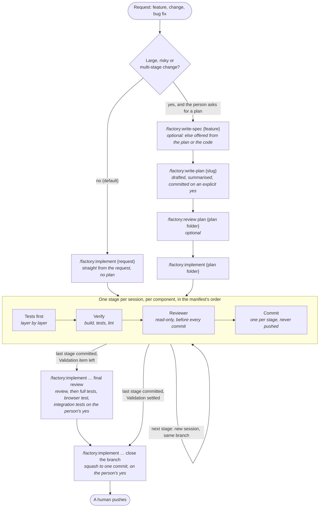

# The flow at a glance

How a feature, a change or a bug fix travels through the factory, from the request to the push. The prose version, with every rule, is `workflow.md`; the commands are in `cheatsheet.md`.

## Reading the diagram

- **Default path.** A request goes straight to `implement`, without a plan. Planning is for large, risky or multi-stage changes, and only when the person asks for it.
- **With a plan.** `write-spec` first when business behaviour is new; a feature with no spec gets one offered, derived from the plan (or, without a plan, from the code); `write-plan` always; the plan is committed only after an explicit yes (silence is not approval); `review plan` is optional.
- **The stage loop.** Each stage runs in a fresh session: tests first, then the component's build, test and lint commands (the noisy ones through `runner`), then the `reviewer` agent, then one commit. Integration tests run only on the person's explicit request.
- **Final review.** With a plan, the Validation checklist records the review and the tests. What the last stage left open, `implement … final review` settles: the review, then the full tests, the browser test and the integration tests the person says yes to; a declined one is marked `[-]`.
- **Closing.** Once the last stage is committed (and, with a plan, every Validation item is ticked or marked `[-]`), `implement … close the branch` squashes the branch to one commit on the person's yes. Agents never push.
