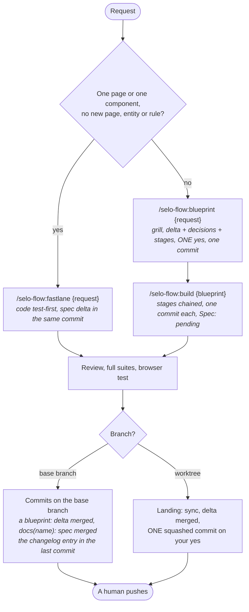

# Cheat sheet

Sessions open at the project's root (or at a worktree of it) with the plugin loaded. Skills carry the plugin's prefix: `/selo-flow:…`. Subcommands are plain words after the command (`/selo-flow:setup update`, `/selo-flow:run web demo`); options are `--{name}` at the end (`/selo-flow:pilot {request} --fastlane --autonomous`); typing `/selo:` shows each command's arguments. Every rule lives in `reference/rules.md`; this page lists the commands.

## Which path?

| I want to… | Do this |
|---|---|
| Set up the project | `/selo-flow:setup` (a front that already has code: its routes scanned, one page stub each) |
| Bring the project up to date with the plugin (a 1.0 project: migrated to pages, domain sheets and blueprints) | `/selo-flow:setup update` |
| Write the specs of existing pages from their code | `/selo-flow:setup specs` (every page stub), `/selo-flow:setup specs {page …}` (those): one yes, one commit |
| Give a front a skin, or switch it | `/selo-flow:setup skin {component} {skin}`, then a blueprint to apply it to existing screens |
| Ask a question, or fix a spec's wording | Just ask. No skill. |
| See a change before it is coded | `/selo-flow:mockup {request}`: a static mockup on the front's skin, iterated until you validate it; then `/selo-flow:pilot {request} --mockup {file}`, which picks the lane (or that lane's command, `--mockup {file}` at its end) |
| Change something on one page, fix a bug | `/selo-flow:fastlane {request}` |
| Let selo pick the lane, and still validate | `/selo-flow:pilot {request}`: the lane said in one line, then run here with its own questions (or `{blueprint}` to resume its build) |
| Have a free sentence routed to its lane | `"SELO_ROUTING": "on"` in your `~/.claude/settings.json` (below): a free change request runs `/selo-flow:pilot`; a new session after the change |
| Try changes one by one on the running app, commit once at the end | `/selo-flow:fastlane {request} --iterate`: no test, review or commit until « on valide » |
| A new page, entity or rule, several pages | `/selo-flow:blueprint {request}`, then `/selo-flow:build {blueprint}` |
| Let it choose the lane and do everything, no click | Selo Ops' « Autonome » box: `/selo-flow:pilot {request} --autonomous` (or `{blueprint}` to resume); ` --mockup {file}`, ` --fastlane`, ` --blueprint`, ` --until-blueprint`, ` --no-browser`, ` --worktree [{name}]` |
| Run a command in a worktree, new or existing | ` --worktree` (a new one) or ` --worktree {name}` at the end of the prompt, before ` --autonomous` (below, "Worktrees") |
| Review recent work, a range, files | `/selo-flow:review` (or `/selo-flow:review {range or files}`) |
| Review a blueprint before building it, or a built one | `/selo-flow:review blueprint {blueprint}`, `/selo-flow:review {blueprint}` |
| Check a page or domain sheet against the code | `/selo-flow:review {slug}` (lists its open blueprints too) |
| Settle open decisions first | `/selo-flow:grill {request}` |
| Click through a front | `/selo-flow:try {component} …` (its demo, else its dev servers, on this worktree's slot, started and stopped by the skill) |
| Start the app, get its URLs | `/selo-flow:run` (`{component}`, `demo`, `stop`): this worktree's slot, ports + 10 per slot; outside a session `node selo-run.mjs` (`npm run app` with `react-express`) |

## The flow



`/selo-flow:pilot` picks the lane and runs it here, with that lane's questions; with ` --autonomous` it runs it with no question (each step a fresh subagent), and in a worktree stops on the landing's yes. A fastlane that meets a new page, entity or rule stops before its commit and proposes `/selo-flow:blueprint {same request}`.

## Fastlane

```
/selo-flow:fastlane Show the due date in red once it has passed
```

The page's code is read, then each component touched: tests first, build + full test + lint, the page or domain spec delta. On the last one: the review of the whole work, the full suites, the browser test. Then one commit per component, each with its `Spec:` line. A page still a stub (`Status: to bootstrap`) first gets the spec of what it does today, on your yes, in its own commit (`docs({page}): bootstrap spec`); a blueprint does the same before its delta.

## Mockup and iterate

- `/selo-flow:mockup {request}` → `.planning/mockups/{date}-{name}.html`, one self-contained file (the skin's tokens and recipes inlined), one plate per state and width, shown as an Artifact or in the browser pane. Each turn ends on `Autre chose, ou on valide ?`. Validated, it gets `<meta name="selo:mockup" content="validated">` beside its `<title>` (removed while `revise` iterates it again) and stays uncommitted: the lane given ` --mockup {file}` (or `/selo-flow:pilot {request} --mockup {file}`) commits it with its work and its browser test compares the page with it. Selo Ops lists the uncommitted mockups that carry the meta.
- In a worktree (`/selo-flow:mockup {request} --worktree`, or a session opened there), the validated file is committed on the branch at once, and its `Next:` line carries ` --worktree {name}` so the build lands there.
- `/selo-flow:fastlane {request} --iterate`: on the base branch it asks first whether to move to a worktree (not with ` --worktree` on the prompt). The app runs on the slot; each turn one change, built, no test, review or commit. « On valide »: the spec delta from the final state, the tests, the review, the full suites, the browser test, then the commits on one yes.
- Neither runs in autonomous mode: both need you. A validated mockup can be built in it: `/selo-flow:pilot {request} --mockup {file} --autonomous`.

## Blueprint lane

1. `/selo-flow:blueprint {request}` → `.planning/blueprints/{date}-{name}.md`: a short grill, then one screen: the spec delta, Business decisions, Technical defaults, stages and their commit subjects, tests, Progress.
2. Read the delta and the stage subjects, say **yes**: one commit. The page and domain specs are untouched.
3. `/selo-flow:build {blueprint}`: every stage chained, one commit each (`Spec: pending (…)`), the decisions it takes under `### Decided during build`, then the review, the full suites, the browser test, and the delta merged into `.planning/pages/` and `.planning/domain/` (`docs({name}): spec merged`). ` --stage N` runs one stage; ` --no-browser` skips the browser test.
4. In a worktree (a branch other than the base branch): the build ends with the landing, one squashed commit on the base branch on your yes. A blueprint committed there is found there: its `Next:` line carries ` --worktree {name}`.

## Pilot

```
/selo-flow:pilot Add a due date to todos
```

The session places the request (one page or one component, no new page, entity or rule: the fastlane; else the blueprint), says the lane and its prompt in one line, then runs it here: the blueprint's grill and one yes, or the fastlane's commit yes. Typing `/selo-flow:pilot` is the yes on the lane. To force a lane, type that lane's command. ` --mockup .planning/mockups/{file}`: built from a validated mockup, passed to the lane picked; a file without the validated meta stops.

` --autonomous`, added by Selo Ops' « Autonome » box (never typed): every question takes its recommended answer, listed as Business decisions (at most five, first in the report) and Technical defaults. Needs the `auto` or `acceptEdits` permission mode with the components' commands allowed. Stops on a real blocker only; `/selo-flow:pilot {blueprint} --autonomous` resumes at its Progress.

## Worktrees

```
/selo-flow:pilot Add a due date to todos --worktree             a new worktree, named from the request
/selo-flow:pilot .planning/blueprints/2026-10-21-due-date.md --worktree due-date   an existing one
/selo-flow:try web --worktree due-date
```

Without ` --worktree`, a command runs where the session was opened: the branch there decides between the base branch (commits as you go) and the worktree variant (commits on its branch, one squashed landing on your yes). With it (last option before ` --autonomous`), the session enters the worktree before anything else and stays there: a new one when no name is given (`pilot`, `fastlane`, `blueprint`, `build`, `mockup`: named from the request or the blueprint), else the existing one of that name (its folder's last segment, or its branch; `review`, `try` and `run` take a name only), created under that name when none exists. It says so in one line: `Worktree {name} · branch {branch} · slot {n}` (the slot its last run took, `no slot yet` before the first). A step that ends in a worktree writes ` --worktree {name}` into its `Next:` lines and names the worktree and its slot in their summary, so the next step runs there from any session; a mockup or a blueprint committed there is found there only, and a lane that misses one says which worktree holds it.

## Your settings

Yours, not the project's, in the `env` block of `~/.claude/settings.json`; a new session after a change:

```json
{
  "env": {
    "SELO_ROUTING": "on",
    "SELO_COMMIT": "auto",
    "SELO_MODELS": "lean",
    "SELO_MODEL_REVIEWER": "fable"
  }
}
```

- `SELO_ROUTING=on`: a free sentence asking to change the application runs `/selo-flow:pilot` on it; a continuation, an answer or a question passes untouched.
- `SELO_COMMIT=auto`: a fastlane on the base branch commits without showing its messages for your yes. The iterate mode's « on valide » still asks its yes, and so does a worktree's landing.
- Both together are the old `routing: auto`: a free sentence that ends in commits with no yes.
- `SELO_MODELS`: the models' preset, `standard` (default: opus to plan, code and review, haiku to run and search) or `lean` (sonnet codes). `SELO_MODEL_{PLANNER|IMPLEMENTER|REVIEWER|RUNNER|EXPLORER}`: one role's model, the others keep the preset (`docs/manifest.md`, "Models").

## Running the app

```
/selo-flow:run            every component, dev servers
/selo-flow:run web demo  the front's demo and the API's, seeded data
/selo-flow:run stop
```

Each worktree that runs the app gets a slot: its ports are the manifest's `port` and `demo_port` + 10 × slot, so two worktrees run side by side and the same worktree keeps its ports. `try` and the browser test of `build` and `fastlane` run on it too. Outside a session: `node selo-run.mjs [component | all] [--demo]` at the project's root, Ctrl+C stops it.

## Commits

```
git add {new files} && git commit --only -m "feat(due-date): api — optional due date" -m "Spec: pending (.planning/blueprints/2026-10-21-due-date.md)" -- {files}
```

- Name the files: never `-a`, `git add -A`, `git add .` or `--amend`.
- A code commit carries `Spec: home +FR-18 ~FR-03 · todo ~BR-06`, `Spec: pending (…)` during a build, or `Spec: none ({reason})`. The commit hook warns when it is missing.
- On the base branch, other sessions share the checkout: `--only`, and a file another session is editing waits for its commit. In a worktree, commits go on its branch and land squashed.
- `.planning/changelog.md`: one entry per work you see (a blueprint, a fastlane's `feat` or `fix`), `- Added|Changed|Fixed — {what the user can now see or do}` under today's `## {date}`, newest first, carried by the work's last commit (`spec merged`, or the fastlane's last commit). A refactor, tests, tooling or docs: none.

## Remember

- Agents **never push**. You push.
- Integration tests run only when you ask, by name.
- `✅ JOB DONE` footer = the job is done: its commits, on the branch named, the `Changelog:` entry it wrote, then one `Next:` line per next step (what it does · `the prompt`); a free request answered without a commit shows the recap alone.
- No footer (a question, a commit to approve, a failure): a `Status:` line says where the job stands, right before the question or the commit. Selo Ops gathers these lines and the footers' recaps into the session's recap.
- Selo Ops: the `selo-feed` plugin, enabled once at user scope (`claude plugin install selo-feed@selo --scope user`), writes one JSON per session and per project under `~/.claude/selo/` (`SELO_OPS_DIR` overrides it), silently, in a selo project or not. `node {selo-feed}/scripts/ops.mjs scan {root}` rescans a project with no session open.
- The session's model is yours to pick: your `SELO_MODELS` and `SELO_MODEL_{ROLE}` say which one each role is meant for. Its subagents follow them: the model hook puts `reviewer`, `runner`, and an `Explore` or `Plan` spawned with no model, on their role's model.
