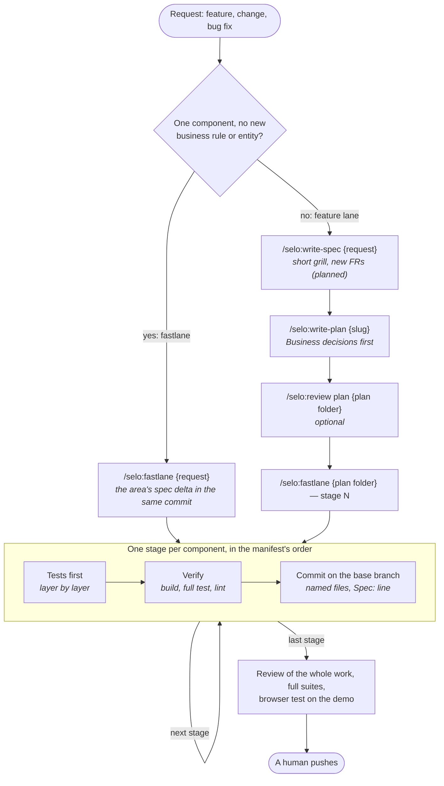

# The flow at a glance

How a feature, a change or a bug fix travels through selo, from the request to the push. The prose version, with every rule, is `workflow.md`; the commands are in `cheatsheet.md`.

## Reading the diagram

- **Two lanes.** The fastlane goes straight to `fastlane`, no plan: one commit per component touched, its spec delta inside. The feature lane writes the spec, then the plan, then the stages. `autopilot` reads the code and picks the lane itself (` — fastlane`, ` — with plan` force it); a fastlane that meets a new rule or entity stops before its commit and moves to the feature lane.
- **The spec follows the code.** Every change of behaviour updates its area's spec in the same commit, and the commit body says how: `Spec: {slug} +FR-48 ~FR-13`, or `Spec: none ({reason})`. `spec-check` checks the ids; the commit hook warns when the line is missing.
- **The stage loop.** Tests first, then the component's build, full test and lint (the noisy ones through `runner`), then one commit naming its files on the base branch. Integration tests run only on the person's explicit request.
- **The last stage.** It reviews the whole work once (the `reviewer` agent), runs the full suites of every touched component and the browser test on the demo (` — without browser test` skips it). Findings left open are settled later with `/selo:review {plan folder}`.
- **Autopilot.** `/selo:autopilot {request | slug | plan folder}` walks the lane it picked, each step a fresh-context subagent, no question: the recommended answers are taken and listed as Business decisions and Technical defaults.
- **No branch, no squash.** Every commit lands on the base branch as it is made; agents never push.
